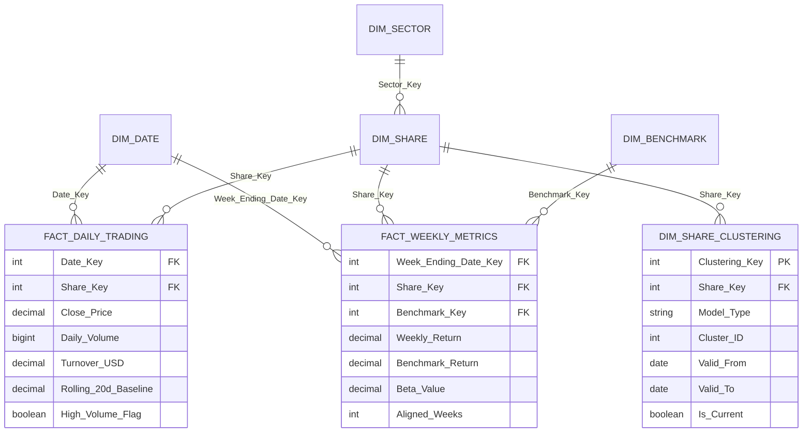

# Market Analysis and Stock Segmentation Using Adapted RFM and Risk-Return Metrics

**Module:** 6BUIS017W CRM & CM With Business Intelligence  
**Assessment:** Individual Coursework CWK1 — CRM Case Study  
**Module Leader:** Dr Panagiotis Chountas  
**Institution:** University of Westminster, School of Computer Science & Engineering  
**Submission Deadline:** 24 November 2026, 13:00  
**GitHub Repository:** `https://github.com/pasanaseniya/CR-CM-Coursework`  
**Study Period:** 1 January 2021 to 1 January 2025 (Terminal Session: 31 December 2024)  
**Observation Date:** 31 December 2024  

---

## Executive Summary & Research Context

Customer Relationship Management (CRM) conventionally applies Recency, Frequency, and Monetary (RFM) segmentation to transactional customer databases to profile purchase recency, purchase regularity, and customer lifetime value. In financial technology and asset pricing, however, equity securities do not exhibit consumer purchase behavior. Instead, equity transactions reflect institutional order execution, market liquidity, and reactions to fundamental news, while returns and volatility capture systematic risk and capital cost.

This investigation adapts RFM principles to equity trading dynamics across the S&P 500 universe over a four-year window (2021–2024, terminating on 31 December 2024). We contrast this adapted trading-activity space against a classic risk-return space defined by mean weekly return and weekly market beta. Using Agglomerative Hierarchical Clustering (Ward linkage) and K-Means partitioning, we evaluate empirical group structures, assess sensitivity to feature collinearity and Monetary omission via the Adjusted Rand Index, and formulate a Kimball dimensional data mart for portfolio managers and fintech analytics teams.

---

## Task 1: Data Preparation, Validation, and Feature Engineering

### 1.1 Ticker Selection and Data Acquisition
The study universe comprises constituent equities of the S&P 500 index. Ticker symbols, company names, and Global Industry Classification Standard (GICS) sectors were scraped from Wikipedia (`https://en.wikipedia.org/wiki/List_of_S%26P_500_companies`) on 19 November 2026. Tickers with dots were converted to hyphens for Yahoo Finance compatibility (e.g., `BRK.B` to `BRK-B`). Daily Open, High, Low, Close, Adjusted Close, and Volume—along with the benchmark index `^GSPC`—were retrieved from 1 January 2021 to 1 January 2025 (exclusive, ending 31 December 2024). Raw responses were persisted locally (`data/market_data_raw.pkl`) to guarantee computational reproducibility.

### 1.2 Data Validation, Alignment, and Survivorship Bias
We applied four explicit validation gates:
1. **Trading Coverage:** Retention required at least 80% valid trading days (minimum 804 of 1,005 completed trading sessions).
2. **Price Sanity:** Daily Close and Adjusted Close prices had to be strictly positive ($P_t > 0$).
3. **History Sufficiency:** Equities required adequate history to accommodate the 20-session pre-event volume baseline and the terminal 60-session calculation window.
4. **Qualifying Spike Occurrence:** Equities needed at least one qualifying volume event across the four-year history. Where no event occurred, Recency was treated as missing (`NaN`) and excluded rather than zero-filled.

Applying these rules retained **491 common shares** and logged 12 exclusions in `data/exclusion_log.csv`. Five tickers lacked trading data (`HONA`, `Q`, `VYLR`, `SNDK`, `FDXF`), six post-2021 IPOs or spinoffs fell below 80% coverage (`KVUE`, `GEHC`, `VLTO`, `SOLV`, `GEV`, `SW`), and one share (`DAY`) registered no volume spike.

#### Survivorship Bias
Applying current constituents retroactively over 2021–2024 introduces survivorship bias. Equities removed due to distress, acquisition, or bankruptcy (e.g., Silicon Valley Bank, Signature Bank, First Republic Bank during 2023) are omitted. Consequently, the retained sample over-represents resilient, surviving firms, artificially lifting aggregate returns and dampening historical downside volatility.

### 1.3 Mean Weekly Return and Weekly Beta Calculation
Daily adjusted closing prices—incorporating dividend reinvestments and splits—were resampled into Friday-ending weeks (`W-FRI`), capturing the final available session price:
$$R_{w} = \frac{P_{w}}{P_{w-1}} - 1$$
Dropping incomplete boundary weeks yielded 208 aligned weekly returns. The return feature is the arithmetic sample mean:
$$\bar{R} = \frac{1}{N} \sum_{w=1}^{N} R_{w}$$

Weekly Beta ($\beta$) measures systematic return sensitivity against the S&P 500 benchmark (`^GSPC`) over matched Friday sessions:
$$\beta = \frac{\text{Cov}(R_{\text{share}}, R_{\text{market}})}{\text{Var}(R_{\text{market}})}$$
Across the 491 shares, beta averaged 1.054 (standard deviation: 0.407), spanning from defensive assets (Newmont `NEM` at 0.354) to high-beta technology shares (Enphase `ENPH` at 2.215, Tesla `TSLA` at 2.084).

#### Benchmark Basis Discrepancy
Individual share series use Adjusted Close (total return including dividends), whereas `^GSPC` is a price-return index excluding dividend reinvestment. This mismatch induces a minor upward intercept shift in share returns equal to the market dividend yield ($\approx 1.5\text{--}2.0\%$ annually), though covariance-based beta slopes remain consistent.

### 1.4 Adapted RFM Feature Engineering
Trading activity was quantified using three adapted measures anchored on **31 December 2024**:
* **High-Volume Event:** Session $t$ qualifies if its trading volume exceeds twice the mean volume of the preceding 20 trading sessions (excluding day $t$):
  $$\text{Volume}_t > 2.0 \times \left( \frac{1}{20} \sum_{i=1}^{20} \text{Volume}_{t-i} \right)$$
* **Recency ($R$):** Elapsed **calendar days** (including weekends and holidays) between the latest qualifying volume event in the valid study history and the observation date (31 December 2024). $R = 0$ if an event occurred on 31 December 2024.
* **Frequency ($F$):** Integer count of qualifying event days within the latest **60 trading sessions** ending 31 December 2024.
* **Monetary ($M$):** Cumulative dollar traded turnover across the latest **60 trading sessions**:
  $$M = \sum_{t=1}^{60} (\text{Close}_t \times \text{Volume}_t) \quad [\text{in USD}]$$
  This reflects capital turnover, not market capitalization or net cash inflow.

### 1.5 Metric Interpretation and Worked Example
For **Apple Inc. (AAPL)** on 31 December 2024:
* Mean Weekly Return: $0.003814$ ($+0.381\%$ weekly; $\approx 21.9\%$ annualized).
* Weekly Beta: $1.1755$ (208 paired return weeks).
* Latest Event: 20 December 2024 ($102.4\text{M}$ shares vs. 20-day mean of $46.8\text{M}$).
* Recency ($R$): $11$ calendar days ($31\text{ Dec} - 20\text{ Dec}$).
* Frequency ($F$): $2$ high-volume sessions within the 60-day window.
* Monetary ($M$): $\$623.30\text{ Billion}$ USD ($\log_{1p}M = 27.158$).

---

## Task 2: Stock Segmentation and Sensitivity Analysis

### 2.1 Feature Preparation, Skewness, and Scaling
Two separate matrices were generated across the 491 common shares:
1. **Risk & Return:** $[\bar{R}, \beta]$
2. **Trading Activity:** $[R, F, \log_{1p}(M)]$

Raw Monetary turnover displayed extreme positive skewness of **$+13.1005$**, driven by mega-cap equities trading hundreds of billions against low-turnover constituents trading under $\$5\text{ Billion}$. Applying natural log $\log(1 + M)$ lowered skewness to **$0.9353$**, preventing dollar turnover from dominating Euclidean distance. Features within both matrices were standardized independently ($z = \frac{x - \mu}{\sigma}$).

| Feature | Raw Skewness | Transformed Skewness | Preprocessing Applied |
| :--- | :---: | :---: | :--- |
| **Mean Weekly Return** | $+0.9240$ | N/A | Standardized |
| **Weekly Beta** | $+1.2584$ | N/A | Standardized |
| **Recency ($R$)** | $+3.6397$ | N/A | Standardized |
| **Frequency ($F$)** | $+0.4208$ | N/A | Standardized |
| **Monetary ($M$)** | $+13.1005$ | **$+0.9353$** | $\log_{1p}$ transformed, then standardized |

### 2.2 Agglomerative Hierarchical Clustering (Ward Linkage)
Ward linkage with Euclidean distance was fitted to both standardized spaces. Dendrograms were constructed for each matrix (`figures/dendrogram_risk_return.png` and `figures/dendrogram_rfm.png`). Silhouette scores across candidate partitions $k \in [2, 8]$ were evaluated:

| Cluster Count ($k$) | Risk & Return Ward Silhouette | Adapted RFM Ward Silhouette |
| :---: | :---: | :---: |
| **$k=2$** | 0.2912 | **0.3665** |
| **$k=3$** | 0.2676 | 0.2659 |
| **$k=4$** | 0.3040 | 0.2686 |
| **$k=5$** | 0.3035 | 0.2889 |
| **$k=6$** | **0.3122** | 0.2696 |
| **$k=7$** | 0.3060 | 0.2729 |
| **$k=8$** | 0.2915 | 0.2887 |

Although $k=2$ maximizes silhouette width in RFM, it isolates extreme dormant outliers rather than identifying functional trading tiers. Selecting **$k=3$** in both matrices achieved balanced group sizes and clear financial interpretability.

### 2.3 K-Means Clustering and Diagnostics
K-Means models ($k \in [2, 8]$) were fitted with `random_state=42` and `n_init=30`. Inertia curves exhibited elbows at $k=3$ (Risk/Return inertia dropped from 629.6 at $k=2$ to 474.6 at $k=3$; RFM dropped from 1,079.3 to 802.5). Silhouette scores verified stable partitioning (0.3213 for Risk/Return, 0.3257 for RFM at $k=3$).

### 2.4 Cluster Profiles in Original Units
Cluster centroids were mapped back into original physical units:

#### Risk & Return Ward Clusters ($k=3$)
* **Cluster 0 — Defensive Assets ($n=254$):** Return mean $0.0011$ ($\approx 5.8\%$ p.a.), Beta $0.812$. Dominated by Utilities and Consumer Staples.
* **Cluster 1 — Core Market Performers ($n=202$):** Return mean $0.0039$ ($\approx 20.3\%$ p.a.), Beta $1.092$. Broad index-tracking Industrials and Financials.
* **Cluster 2 — High-Beta Momentum Leaders ($n=35$):** Return mean $0.0089$ ($\approx 46.3\%$ p.a.), Beta $1.546$. Hyper-growth semiconductor and platform tech shares (NVDA, AVGO, LLY).

#### Adapted RFM Ward Clusters ($k=3$)
* **Cluster 0 — Active Regulars ($n=247$):** Recency $11.89$ days, Frequency $3.07$ events, 60-day turnover **$\$47.66\text{ Billion}$**.
* **Cluster 1 — Dormant Outliers ($n=87$):** Recency **$56.92$ days**, Frequency $0.62$ events, 60-day turnover $\$48.21\text{ Billion}$.
* **Cluster 2 — Mid-Tier Moderate Liquidity ($n=157$):** Recency $13.65$ days, Frequency $2.41$ events, 60-day turnover **$\$11.08\text{ Billion}$**.

Cross-algorithm agreement on identical shares was quantified via the Adjusted Rand Index:
$$\text{ARI}(\text{Ward RR}, \text{K-Means RR}) = 0.1894 \quad | \quad \text{ARI}(\text{Ward RFM}, \text{K-Means RFM}) = 0.3475$$
The lower ARI in Risk/Return reflects K-Means imposing spherical partitions around high-beta equities, whereas Ward creates layered horizontal cuts across return tiers.

### 2.5 RFM Sensitivity Analysis

#### 2.5.1 Correlation Matrix and Distance Weighting
Correlations between $R$, $F$, and $\log_{1p}(M)$ were calculated:

| Feature Pair | Pearson ($r$) | Spearman ($\rho$) | Behavioural Finding |
| :--- | :---: | :---: | :--- |
| **Recency vs. Frequency** | **$-0.3447$** | **$-0.1911$** | Negative correlation: recent spikes align with higher activity counts. |
| **Recency vs. $\log_{1p}(M)$** | $+0.1512$ | $+0.1449$ | Modest positive correlation. |
| **Frequency vs. $\log_{1p}(M)$** | $+0.0086$ | $-0.0424$ | Near-zero linear independence. |

Because $R$ and $F$ exhibit moderate collinearity ($r = -0.345$), they partially duplicate information along an activity axis in Euclidean space, giving event timing greater geometric weight than dollar turnover.

#### 2.5.2 Monetary Removal Experiment
To test whether Monetary ($M$) was driving group membership or acting as a size proxy, Ward clustering was refitted using **only Recency and Frequency** ($[R, F]$ standardized afresh at $k=3$). Comparing assignments yielded:
$$\text{Adjusted Rand Index (ARI)} = 0.3791$$
An ARI of 0.3791 demonstrates that removing $M$ reassigns over 62% of share pairs. In the 3-feature solution, Cluster 2 isolated small-dollar turnover shares (mean $\$11.08\text{B}$ vs $\$47.66\text{B}$). Under the 2-feature solution, traded turnover distributions became indistinguishable across clusters (means of $\$32.8\text{B}$, $\$34.3\text{B}$, and $\$48.1\text{B}$). This confirms that **Monetary value primarily distinguishes liquidity scale rather than temporal trading activity**.

---

## Task 3: Business Intelligence and Critical Review

### 3.1 Data Mart Design

#### 3.1.1 Grain, Facts, and Dimensions
A Kimball star schema integrates trading facts and dimensional context across two granularities:
1. `Fact_Daily_Trading` (grain: one record per share per trading date; facts: Close price, Volume, Dollar turnover, 20-day baseline, high-volume event indicator).
2. `Fact_Weekly_Metrics` (grain: one record per share per Friday week; facts: weekly share return, benchmark return, weekly beta).
These link to conformed dimensions: `Dim_Date` (trading calendar, holidays), `Dim_Share` (ticker, corporate identifier, company name), `Dim_Sector` (GICS classification), and `Dim_Benchmark` (^GSPC index).

#### 3.1.2 Provenance and Calculation History
An audit table (`Pipeline_Execution_Log`) logs execution timestamps, environment dependencies, parameter configurations (20-day baseline, 2.0 threshold, 60-day window), and observation date snapshots. `Dim_Share_Clustering` applies Slowly Changing Dimensions (SCD Type 2) with valid date ranges (`Valid_From`, `Valid_To`, `Is_Current`) to track cluster migration across quarterly rebalancing.

#### 3.1.3 Analytical and Stakeholder Support
Portfolio managers slice `Fact_Weekly_Metrics` across sectors to filter defensive low-beta equities. Concurrently, fintech BI dashboards query `Fact_Daily_Trading` to generate real-time alerts when volume frequency spikes without return momentum.

---

### 3.2 Review of Results and Visualisation (472 words)

#### 3.2.1 Cluster Profiles and Sector Composition
Cross-tabulating Risk/Return clusters against Adapted RFM partitions demonstrates that market sensitivity and trading activity are fundamentally decoupled. High-Beta Momentum equities (Cluster 2, $n=35$, mean return $+46.3\%$ p.a., beta 1.55) are concentrated in Information Technology ($68.6\%$) and Consumer Discretionary ($20.0\%$). However, their trading activity bifurcates: $65.7\%$ map to Active Regulars (RFM Cluster 0), while $34.3\%$ map to Mid-Tier Turnover (RFM Cluster 2).

Conversely, Defensive equities (Cluster 0, $n=254$, beta 0.81) dominate Utilities ($100\%$) and Consumer Staples ($89.2\%$). Yet their RFM behavior spans all tiers: $48.4\%$ are Active Regulars, $18.5\%$ are Dormant Outliers (mean recency 56.9 days), and $33.1\%$ are Mid-Tier. Low market sensitivity does not guarantee low liquidity; defensive assets experience intense turnover during macroeconomic rotations.

#### 3.2.2 Sensitivity Findings and Business Uses
The ablation experiment confirms that Monetary turnover dictates major cluster boundaries (ARI $= 0.3791$). In asset management, retaining $M$ is essential for liquidity screening: institutional funds with mandate constraints must avoid illiquid names regardless of volume spikes.

Conversely, for fintech trading desks and campaign analytics, the 2-feature $[R, F]$ model provides superior utility. It highlights abnormal trading surges without favoring mega-cap market capitalizations, alerting execution desks to sudden institutional interest in overlooked equities.

#### 3.2.3 Critical Evaluation and Limitations
Five core methodological limitations must qualify these conclusions:
1. **Return Dependencies and Non-Linearity:** Weekly beta presumes a linear market model. It ignores tail dependence, co-skewness, and systemic breakdown during crises. True diversification requires copula modeling or dynamic covariance estimation, not beta sorting alone.
2. **Benchmark Basis Mismatch:** Using the unadjusted S&P 500 price index (`^GSPC`) against dividend-adjusted equity prices introduces an upward return drift equal to market dividend yield ($\approx 1.5\text{--}2.0\%$ annually). While beta slopes remain unbiased, absolute alpha is distorted.
3. **Survivorship Bias:** Conditioning on the modern constituent list ignores failures over 2021–2024, artificially elevating mean returns and underestimating drawdown risks.
4. **Euclidean Geometry on Correlated Features:** Negative correlation between $R$ and $F$ ($r = -0.345$) gives repeated weight to event timing in Euclidean space. Mahalanobis distance would provide affine-invariant metric scaling.
5. **Liquidity Proxy Constraints:** Dollar turnover ($M$) measures past traded volume, not market microstructure depth. It ignores bid-ask spreads, order book depth, and market impact costs.

**Predictive Warning:** These clusters are retrospective, descriptive characterizations of historical 2021–2024 behavior. They possess zero guaranteed predictive power for future equity returns. Constructing investment portfolios based on historical cluster membership commits the post-hoc fallacy and exposes investors to severe regime-shift losses.

---

## 4. Conclusion & GitHub Repository

This research establishes that adapting RFM metrics to financial markets offers valuable diagnostic insight into institutional order activity, provided it is kept distinct from risk and return metrics. Blending these spaces into a single composite rank conceals the structural tension between market sensitivity and trading liquidity.

All source code, automated test suites, cached data snapshots, and the executed Google Colab notebook are available in the public repository:
* **GitHub Repository:** `https://github.com/pasanaseniya/CR-CM-Coursework`
* **Google Colab Notebook:** `CR_CM_Coursework_Final.ipynb`
* **Data Artifacts:** `data/features_all.csv`, `data/exclusion_log.csv`, `data/cluster_assignments.csv`

---

## References

* Fama, E.F. and French, K.R. (1993) 'Common risk factors in the returns on stocks and bonds', *Journal of Financial Economics*, 33(1), pp. 3–56.
* Kaufman, L. and Rousseeuw, P.J. (2009) *Finding groups in data: an introduction to cluster analysis*. Hoboken: John Wiley & Sons.
* Kimball, R. and Ross, M. (2013) *The data warehouse toolkit: the definitive guide to dimensional modeling*. 3rd edn. Indianapolis: John Wiley & Sons.
* Markowitz, H. (1952) 'Portfolio selection', *The Journal of Finance*, 7(1), pp. 77–91.
* Rousseeuw, P.J. (1987) 'Silhouettes: a graphical aid to the interpretation and validation of cluster analysis', *Journal of Computational and Applied Mathematics*, 20, pp. 53–65.
* Sharpe, W.F. (1964) 'Capital asset prices: A theory of market equilibrium under conditions of risk', *The Journal of Finance*, 19(3), pp. 425–442.
* Ward, J.H. (1963) 'Hierarchical grouping to optimize an objective function', *Journal of the American Statistical Association*, 58(301), pp. 236–244.
